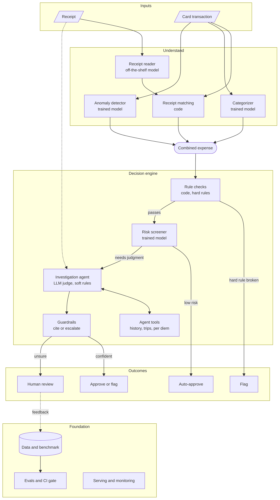

# Architecture (logical view)

This page shows what each part of the system does and how one transaction moves through it. It does not say what each part is built with: that is in `tech-stack.md`.

## How a transaction moves through the system

A transaction passes through four groups of components:

1. **Inputs:** a card transaction arrives, sometimes with a receipt.
2. **Understand:** the system reads the receipt, matches it to the charge, assigns a spend category, and scores how unusual the amount is.
3. **Combined expense:** everything learned so far is gathered into one record per transaction.
4. **Decide:** checks and models read that record and send the transaction to one of four outcomes.

A fifth group, **Foundation**, supports the others: test data, evaluations, and running the system in production.

If your viewer doesn't render Mermaid, see the [rendered architecture diagram](img/architecture.svg).

### How the decision is made

The decision engine works in order, and each step only sees what the step before it let through:

1. **Rule checks** test the hard rules. A broken hard rule is flagged right away.
2. **The risk screener** looks at everything that passed. Low-risk transactions are approved automatically.
3. **The investigation agent** handles the rest. It is an LLM judge for the soft rules that need judgment. It can look things up with its tools and can read the receipt.
4. **Guardrails** check the agent's answer. A confident answer that cites a rule is approved or flagged. Anything else goes to a person.

Human review decisions are fed back into the test data, so the system can be measured against them.

### How transactions get in

- A UI for uploading one transaction.
- An API for sending transactions in batches.

## Components

| Group | Component | Kind | What it does |
|---|---|---|---|
| Understand | Receipt reader | Off-the-shelf model | Reads a receipt image and returns its fields as JSON. Candidates: `AdamCodd/donut-receipts-extract`, the Qwen2.5-VL-7B family, NuExtract3. |
| Understand | Receipt matching | Code | Links each receipt to its card transaction. |
| Understand | Categorizer | Trained model | Assigns one of the categories listed in `osu_rules.yaml`. |
| Understand | Anomaly detector | Trained model | Catches unusual spending that the fixed rules miss. Needs each cardholder's past spending as input. |
| Combine | Combined expense | Data record | One record per transaction: its fields, receipt, category, and anomaly score. Every later step reads this record. |
| Decide | Rule checks | Code | Runs the `method: code` checks from the rules YAML. A broken hard rule produces a flag. |
| Decide | Risk screener | Trained model | Approves low-risk transactions automatically. Sends the rest to the agent. |
| Decide | Investigation agent | LLM judge | Runs the `method: llm` checks. Uses its tools and reads the receipt. |
| Decide | Guardrails | Code | Makes sure every decision cites a rule. If it can't, the transaction goes to a person. |
| Foundation | Data and benchmark, evals and CI gate, serving and monitoring | Data and infrastructure | Hold the test data, block bad changes from merging, and run the system. Human review decisions feed back into the benchmark. |

## Open questions

- ~~**Who reads the anomaly score?**~~ Settled: the risk screener and the investigation agent read it, and the rule checks don't. See `decisions.md`. The diagram feeds it into the combined expense, so every later step could read it. Should only the risk screener use it, or the rule checks too?
- ~~**What is "Approve or flag" for?**~~ Settled: it is the agent's decision, `agent_approve` or `agent_flag`, made with citations. See [contracts.md](contracts.md).
