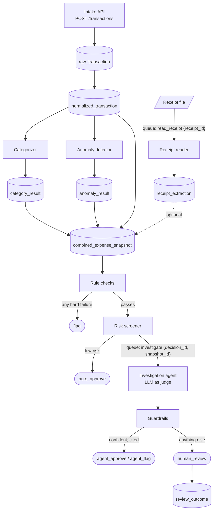
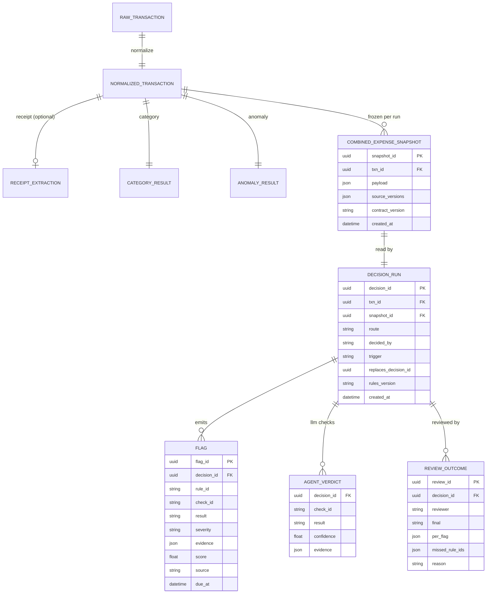

# Contracts

This page is the contract between the parts of Flag-It. It says what each stage receives, what it hands to the next stage, and what the APIs accept and return. Every component is built against this page.

- **First half: how a transaction moves.** A plain-language walkthrough of one transaction, with the reasons behind each handoff.
- **Second half: reference.** Field tables, API endpoints, and JSON examples.

**Status:** the field definitions now live in code, in `src/flag_it/contracts/`. The generated JSON Schemas are in `src/flag_it/contracts/schema/`. If this page and the code disagree on a field, the code wins, and this page should be fixed. This page keeps the flow, the handoffs, and the reasons.

**Related pages:**
- Database tables, types, and indexes: [schema.dbml](schema.dbml), generated from the migrations in `src/flag_it/db/migrations/`.
- The rules and checks themselves: `policies/osu/osu_rules.yaml`, explained in `policies/README.md`.

## Terms used on this page

| Term | Meaning |
|---|---|
| Record | One unit of data that a stage produces, such as a normalized transaction or a flag. |
| Handoff | The point where one stage's output becomes the next stage's input. |
| Snapshot | A saved, never-changing copy of the combined expense that one decision run reads. |
| Decision run | One pass of the Decide stages over one snapshot. It ends in one route. |
| Route | Where a transaction ends up: `flag`, `auto_approve`, `agent_approve`, `agent_flag`, or `human_review`. |
| Append-only | Rows are only added, never edited or deleted. A rerun adds new rows next to the old ones. |
| Contract version | The version of the record shapes (the schema) in this contract. It is stamped on JSON that is saved and read back later, so the reader knows which shape to expect. See [Versioning](#versioning). |
| Check method | How a check is evaluated, set in the rules YAML. `code` checks are deterministic Python. `llm` checks need judgment and are run by the investigation agent. |
| Hard failure | A failed `code` check that stops the run with route `flag`: result `fail` or `violation`, on a rule whose severity is `prohibited`, `conditional`, or `documentation`. A `guidance` failure is recorded but doesn't stop the run. Results `pending` and `not_evaluated` never count. |
| Guardrails | Plain code that checks the agent's answer before it is accepted, and sends the run to a person if the answer isn't trustworthy. |
| Queue | A waiting line for slow jobs (Redis with the Arq library). A worker picks up a job, does it, and writes the result to Postgres. Failed jobs are retried automatically. |
| MCC | Merchant category code: the card network's label for the kind of business a merchant is. |
| Schema | A machine-readable description of a record's fields and types. Code uses it to reject malformed data. |

## How a transaction moves through the system



If your viewer doesn't render Mermaid, see the [rendered flow diagram](img/contracts-flow.svg).

How to read it: boxes are stages, cylinders are Postgres tables, rounded boxes are routes (final outcomes). Labels starting with `queue:` are jobs sent through the queue, with the IDs they carry.

### 1. A transaction arrives

A client sends one transaction or a batch to the intake API. Each transaction carries an `external_id` chosen by the client. The API stores it as a raw transaction, exactly as received, and answers right away with `202 Accepted` (HTTP for "received, will be processed later"). It does not wait for a decision: the rest of the pipeline runs in the background. The client asks for the result later with `GET /transactions/{txn_id}`, which shows no decision until the background work finishes.

**Why:**
- The agent step can take minutes, so the API can't hold the request open until a decision exists.
- `external_id` makes sending the same transaction twice harmless. The second copy is reported as `duplicate` and not processed again.
- In a batch, each item succeeds or fails on its own. One bad row doesn't reject the other 999.

### 2. The transaction is normalized

Normalization turns the raw text into typed fields: real dates, a decimal amount, a cardholder key, and a cleaned merchant name. The raw row is kept unchanged, so flags can quote the original text.

### 3. The Understand stages add what they learn

Three stages each write one result row, keyed on `txn_id` plus the version of the model that produced it:

- **Receipt reader** (only if there is a receipt): reads the receipt file and records its fields and line items.
- **Categorizer:** assigns a spend category. The category decides which rules apply.
- **Anomaly detector:** scores how unusual the amount is for this cardholder.

The receipt reader runs on the GPU machine, so it goes through a queue. The queue message holds only IDs. The worker reads the file and writes its result to Postgres.

**Why IDs only:** Postgres stays the one place where data lives. A message can't go stale, and a schema change doesn't break messages that are already waiting in the queue.

### 4. Everything is frozen into a snapshot

At the start of each decision run, the pipeline builds the combined expense once and saves it as a `combined_expense_snapshot` row. That row never changes. Rule checks, the risk screener, the agent's queue message, and the final decision all point to the same `snapshot_id`.

**Why:** the agent runs later than the rule checks. Without a snapshot, a receipt or a retrained categorizer could arrive in between, and the stages would decide on different data. With a snapshot, every stage sees the same input, and you can always answer "what did the system know when it decided?"

The snapshot holds the combined expense as one JSON value, not split into columns. The parts already live in their own tables. The snapshot freezes how they looked together at one moment.

`snapshot_id` is assigned when the snapshot row is saved. It is not a field inside the combined expense. Other records refer to the snapshot by this ID, the same way they refer to a transaction by `txn_id`.

### 5. Rule checks run

Every `code` check that applies to the transaction's category runs. Each failure becomes a flag. If any failure is a hard failure (a broken rule that isn't just guidance; see [Terms](#terms-used-on-this-page)), the run ends with route `flag`. The risk screener and the agent are skipped.

**Why run all checks instead of stopping at the first failure:** the reviewer sees every reason at once, and the labels are more complete. Code checks cost almost nothing.

### 6. The risk screener decides what the agent sees

Transactions that pass the rule checks go to the risk screener, a trained model that estimates how likely the transaction is to break a rule. It can use the anomaly score as one of its inputs. If that probability is below the threshold stored with that model version, the route is `auto_approve`. Otherwise the pipeline puts an `investigate` job on the queue, holding the `decision_id` and `snapshot_id`.

**Why:** the agent is slow and costs money per call. The screener lets clearly fine transactions through without it.

**At first:** the screener is trained on review outcomes, which don't exist yet. Until they do, a stand-in returns probability 1.0, so every transaction that passes the rule checks goes to the agent.

### 7. The agent judges, and the guardrails check its answer

The investigation agent is a language model that runs the `llm` checks. It reads the snapshot, including the receipt and the anomaly score, and can look things up with its tools (see [Agent tools](#agent-tools)). It may cite the anomaly score as context, but every `fail` must cite a rule. It returns one verdict per check: `pass`, `fail`, or `unsure`, with a confidence and the evidence it relied on.

The guardrails then check that answer. The run goes to `human_review` if any of these is true:

- A verdict is `unsure`.
- A confidence is below the threshold set in the rules YAML.
- A citation points to something that doesn't exist.
- The agent's output fails schema validation after one retry.

Otherwise the route is `agent_flag` if any verdict is `fail`, or `agent_approve` if all verdicts pass.

**Why one verdict per check:** each decision can be traced to a specific rule, and the guardrails can verify each citation.

### 8. A person reviews what needs a person

For a `human_review` run, a reviewer records:
- their final call
- whether they agree with each flag
- any rules the system missed
- a reason

Reviewers can also review other routes. These outcomes become labels for the risk screener, for the judge evaluation, and for tracking missed violations.

### 9. When a receipt arrives later

A transaction without a receipt is decided right away. Checks that need a receipt report `not_evaluated: missing receipt`. A rule that requires a receipt treats the missing receipt as a finding.

When the receipt arrives, it is read and matched, and the pipeline starts a **new snapshot and a new decision run**. The old run stays as history. A transaction's runs form one chain: each run replaces at most one earlier run, and only one run per transaction is `initial`. The current decision is the run that no later run replaces.

Every run records why it ran (`trigger`: `initial`, `late_receipt`, or `deadline`) and which run it replaces (`replaces_decision_id`, empty for `initial`). So a transaction's history reads as a chain: run 1 (initial) → run 2 (late receipt) → run 3 (deadline).

If a person already reviewed an earlier run, the new run compares its route with the reviewer's final call:

- **They agree** (for example, the reviewer approved and the new run approves): the new route stands. No second review.
- **They disagree** (for example, the reviewer approved, but the receipt now shows a problem and the run would flag): the route becomes `human_review`, with `decided_by: rerun` and escalation reason `review_conflict`, so a person settles the conflict.

**Why:** a machine never silently overrules a person, but a person isn't asked to confirm what they already decided.

### 10. When a deadline passes

Some checks have a deadline, such as a document due at billing-cycle sign-off. Before the deadline they report `pending`, which doesn't stop the run. A `pending` flag carries `due_at`, the moment its deadline passes. A scheduled job finds `pending` flags on current runs whose `due_at` has passed and starts a new snapshot and a new decision run, as in step 9. If the document is still missing, the check now fails and the new run routes to `flag`.

## Rules that hold everywhere

- **Every flag has the same core fields:** `rule_id`, `severity`, `evidence`, and `score`, whether a code check or the agent produced it. Only those two create flags. The risk screener never does: its score isn't tied to a rule, so it only routes, and its result is saved on the decision run.
- **`severity` comes from the rule** in the rules YAML: `prohibited`, `conditional`, `documentation`, or `guidance`. It describes how much the rule matters, so it is the same for every flag of that rule, whatever the transaction. What is specific to one transaction is the flag's `result` (what happened) and `score` (how sure we are).
- **`score` is confidence,** from 0 to 1, in the flag's `result`. Code checks score 1.0. The agent gives its stated confidence. How far over a limit a charge was goes in `evidence`, not in `score`.
- **Evidence is a list of citations** that the guardrails can check (see [Evidence](#evidence)).
- **Results are append-only,** keyed on `txn_id` plus a version. Snapshots, decision runs, flags, and review outcomes are never edited. The one exception: a decision run's `route`, `decided_by`, and `escalation_reasons` are filled in once, when the agent finishes. The database enforces both.
- **Some rows are database-only.** An uploaded receipt file (`receipt_file`) and a saved agent answer (`agent_verdict`) are stored but never handed from one stage to another, so they have no contract record. Their models are in `src/flag_it/db/rows.py`.
- **IDs are stable.** Rule and check IDs are never reused or renumbered. Retire one with `status: retired`.
- **Thresholds live in the rules YAML** (`params`), not in code.
- **Money is a decimal,** never a float.

## Versioning

The record shapes will change over time: a field is added, renamed, or changes type. This is schema versioning. It has two jobs:

1. **Make every change visible in review.** A change to a record shape must come with a version bump.
2. **Let saved JSON say which shape it was written in.** Some data is saved as JSON and read back later, after the code may have changed. The reader needs to know which shape to expect.

The contract has one version number, `CONTRACT_VERSION`, written as `MAJOR.MINOR.PATCH` (for example `1.2.0`). A major bump means old readers can no longer read new data.

**What gets stamped,** and why only these:

| Stamped | Why it needs the stamp |
|---|---|
| Snapshot (`payload`) | It is read months later, for audits, retraining, and reruns, possibly by newer code. |
| Queue jobs | A job can wait in the queue while a new version of the code is deployed. |
| API responses | Clients can tell which shape they received. |

Ordinary table columns, such as those of `decision_run`, are not stamped. Database migrations already change those tables and their existing rows together, so the rows always match the current shape.

| Change | Bump | Example |
|---|---|---|
| Add an optional field | Minor | Add `mcc_code` |
| Remove, rename, or retype a field, or make a field required | Major | Change `amount` from string to decimal |
| Wording or descriptions only | Patch | Fix a field description |

Schema files (JSON Schema, generated from the Python models) are committed to the repo. CI regenerates them and fails if they don't match the models, or if they differ from `main` but `CONTRACT_VERSION` isn't higher than on `main`. A worker rejects a job whose major version differs from its own.

**Strict for input, tolerant for records.** Data that enters the system from outside (API request bodies, the agent's output, the rules YAML) rejects unknown fields, so typos fail loudly. Saved and queued records (snapshots, jobs, decision runs, flags, results) ignore unknown fields. Otherwise a minor bump would break old readers: a worker still on 1.0.0 could not read a 1.1.0 job that has a new optional field.

## Reference

### Records



If your viewer doesn't render Mermaid, see the [rendered record diagram](img/contracts-records.svg). Each line reads as "one X has one (or many) Y".

### Raw transaction

`raw_transaction` is one row of the source export, exactly as loaded. Every field is text, so nothing is changed by accident during loading.

| Field | Notes |
|---|---|
| `raw_id` | Our key for the row. |
| `source_file`, `source_line_no` | The file and line the row came from. The public data comes as one export file per month, so a single source has many files. Together these two fields identify the row, so loading the same file twice does not create duplicates. Rows from the intake API have no file; they are identified by `(source, external_id)` instead. |
| `source_rowid` | The state's `ROWID`. Kept for reference only. **Do not use it as an ID:** the state reuses the same ROWID for different transactions in different monthly files, and it is blank in the Sep and Oct 2023 files. |
| `calendar_year`, `calendar_month` | The posting period. Some file names don't match the period inside them. |
| `agencynbr`, `agencyname` | The agency. Use the number: names are spelled several ways. OSU is `01000`. |
| `last_name`, `first_initial` | The only cardholder information. There is no card number. |
| `item_descr` | What was bought. Cut off and often generic. Several lines can be joined with `\|`. |
| `amount` | Text. Negative values are refunds or credits. |
| `merchant_name` | The merchant name as the card processor sent it (`MERCHANT` in the export): padded, cut off, with prefixes (`SQ *`) and reference numbers. |
| `transaction_date`, `post_date` | Format `dd-MON-yy`. |
| `mcc_description` | The MCC label, cut off at 40 characters. The 4-digit code is not in the export. |

Transactions sent through the intake API also carry `external_id` and `source` (see [Intake API](#intake-api)). They may also carry `mcc_code` and `business_purpose`, which the public export lacks.

### Normalized transaction

`normalized_transaction` is the cleaned-up version of a raw row. Raw values are not copied here: they stay in the raw row, linked by `raw_id`. Fields the public data lacks may be empty, so a richer data feed can fill them later without changing the contract.

| Field | Required | Comes from | Notes |
|---|---|---|---|
| `txn_id` | yes | assigned | Our own key, independent of the source system. |
| `raw_id` | yes | raw | Link back to the raw row. |
| `agency_id` | yes | raw `agencynbr` | Whitespace removed. |
| `cardholder_id` | yes | derived | A stand-in for a card ID: `agency_id\|LASTNAME\|I`. Two people in one agency with the same last name and initial get merged. A real card ID replaces this when available. |
| `merchant_norm` | yes | derived | A cleaned merchant name, used to group charges (for example, to catch a purchase split into several). |
| `mcc_description` | yes | raw | |
| `mcc_code` | no | not in public data | |
| `amount` | yes | raw | Decimal. Can be negative. |
| `transaction_date`, `post_date` | yes | raw | Dates. |
| `business_purpose` | no | not in public data | The cardholder's reason for the purchase. Read by `llm` checks. |
| `normalizer_version` | yes | code | Which normalizer version produced this row. |

### Receipt extraction

`receipt_extraction` holds what was read from a receipt. It is optional.

| Field | Notes |
|---|---|
| `receipt_id`, `reader_model` | Key. `receipt_id` is the uploaded file (returned by the upload endpoint and carried by the `read_receipt` job). `reader_model` is the exact model tag and quantization. |
| `txn_id` | The transaction the receipt was uploaded against. |
| `match_status` | `matched`, `mismatch` (merchant, date, or total is outside its tolerance), or `unmatched` (the reader couldn't read enough fields to compare). A mismatch is a finding. In v1 every receipt is uploaded against a known transaction, so matching only verifies; it never searches for the transaction. Tolerances are in a config file. |
| `merchant`, `receipt_date`, `subtotal`, `tax`, `tip`, `total` | Empty when unreadable. An empty value is better than a confident wrong one. |
| `line_items` | A list of `{description, quantity, unit_price, amount, line_type}`. The only source for tax, tip, room rate, and seat class. |

### Category result

| Field | Notes |
|---|---|
| `txn_id`, `model_version` | Key. `model_version` is the lookup file or model version. |
| `category` | One of the IDs under `categories:` in the rules YAML. |
| `confidence` | From 0 to 1. |
| `method` | `lookup` (MCC-to-category table) or `model` (trained categorizer). |

### Anomaly result

| Field | Notes |
|---|---|
| `txn_id`, `model_version` | Key. |
| `score` | How far this amount is from the cardholder's typical amount, in units of their usual spread (a robust z-score: it uses the median, so a few odd past charges don't distort it). 0 is typical; higher is more unusual. Empty when `status` is `insufficient_history`. |
| `status` | `scored` or `insufficient_history`. Insufficient history is not the same as a score of 0. |
| `history_length` | How many past transactions were used. |
| `as_of` | Only transactions before this time are used, so the score never uses future data. |

### Combined expense snapshot

`combined_expense_snapshot` is the frozen input to one decision run. There is one row per run, not per transaction.

| Field | Notes |
|---|---|
| `snapshot_id` | Key. |
| `txn_id` | The transaction. |
| `payload` | The combined expense: `{transaction, receipt, category, anomaly}`. `receipt` is `null` when there is none. Parts stay nested so each keeps its own version. |
| `source_versions` | The version of each part: normalizer, reader model, categorizer, anomaly model. |
| `contract_version` | The contract version the payload was written under. |
| `created_at` | When the snapshot was taken. |

### Decision run

`decision_run` is one pass of the Decide stages over one snapshot.

| Field | Notes |
|---|---|
| `decision_id` | Key. |
| `txn_id`, `snapshot_id` | What was decided and the exact input. |
| `route` | `flag`, `auto_approve`, `agent_approve`, `agent_flag`, or `human_review`. Empty while the agent is still working, then filled in once. |
| `decided_by` | Who chose the route. Each can choose only its own routes: `rules` → `flag`; `screener` → `auto_approve`; `agent` → `agent_approve` or `agent_flag`; `guardrails` → `human_review` (the agent's answer wasn't trustworthy); `rerun` → `human_review` (the run disagreed with an earlier review). |
| `trigger` | Why the run started: `initial`, `late_receipt`, or `deadline`. |
| `replaces_decision_id` | The run this one replaces. Empty exactly when `trigger` is `initial`. |
| `screener` | `{probability, threshold, model_version}`, or empty if the screener was skipped. The threshold is copied from that model version's metadata. A probability below the threshold auto-approves. |
| `escalation_reasons` | Present exactly when the route is `human_review`. One or more of: `unsure:<check_id>`, `low_confidence:<check_id>`, `citation_unresolved`, `invalid_output`, `agent_failed`, `review_conflict`. |
| `rules_version` | The rules YAML used for this run: its `policy.version`, a `+`, and the first 12 characters of the file's SHA-256 hash, for example `2026-05+3f9a1c0b7e2d`. It changes whenever the file changes. |
| `created_at` | When the run started. |

### Flag

| Field | Notes |
|---|---|
| `flag_id` | Key. |
| `decision_id`, `txn_id` | The run that produced it. |
| `rule_id`, `check_id` | Stable IDs from the rules YAML, such as `OSU-TRV-13` and `OSU-TRV-13a`. |
| `result` | `fail`, `violation`, `unclear`, `pending`, or `not_evaluated`. A missing input is `not_evaluated`, with the missing input named in `evidence`. |
| `severity` | Copied from the rule. |
| `evidence` | A list of citations (below). |
| `score` | Confidence from 0 to 1. |
| `source` | `code` (a rule check) or `llm` (the agent). |
| `due_at` | When the deadline passes. Present exactly when `result` is `pending`. |

### Evidence

Each item in `evidence` is one citation:

| Field | Notes |
|---|---|
| `kind` | `field`, `receipt`, `policy`, `tool_result`, or `history`. |
| `ref` | Where the value came from. The guardrails check that it exists. |
| `value` | The value that was used. |
| `note` | Optional explanation. |

What `ref` points to for each `kind`:

| `kind` | `ref` example |
|---|---|
| `field` | `transaction.amount`, or `raw.merchant_name` for the original text |
| `receipt` | `receipt.line_items[2]` |
| `policy` | `OSU-TRV-13` or `params.lodging_max_nightly` |
| `tool_result` | The ID of the agent's tool call |
| `history` | The query name and its `as_of` time |

Example: a code check finds a charge over a limit. It cites the amount it read and the limit from the rules YAML.

```json
{
  "rule_id": "EXAMPLE-01",
  "check_id": "EXAMPLE-01a",
  "result": "fail",
  "severity": "conditional",
  "score": 1.0,
  "source": "code",
  "evidence": [
    {"kind": "field", "ref": "transaction.amount", "value": "412.00"},
    {"kind": "policy", "ref": "params.example_limit", "value": "300.00", "note": "Over by 112.00"}
  ]
}
```

`EXAMPLE-01` and `example_limit` are placeholders, not real entries in the rules YAML.

### Agent verdict

The agent returns one verdict for each `llm` check it was given. The output is forced to this schema.

The agent's whole answer is `{"verdicts": [...]}`, with each check appearing once.

| Field | Notes |
|---|---|
| `check_id` | The check being judged. |
| `result` | `pass`, `fail`, or `unsure`. A `fail` becomes a flag with result `fail`. An `unsure` becomes a flag with result `unclear` and sends the run to a person. |
| `confidence` | From 0 to 1. |
| `evidence` | A list of citations, as above. A `fail` or `unsure` needs at least one, and a `fail` needs at least one `policy` citation. |

### Agent tools

All tools are read-only and take an `as_of` time, so they never see data from after the transaction. Every call is logged with a `tool_call_id`. A `tool_result` citation points to that ID, and the guardrails check that it exists.

| Tool | Returns | Status |
|---|---|---|
| `cardholder_history` | The cardholder's past transactions before `as_of`. | v1 |
| `merchant_history` | How often this cardholder and agency used this merchant before `as_of`. | v1 |
| `policy_lookup` | The full rule text and PDF section for a `rule_id`. | v1 |
| `per_diem_rate` | The GSA lodging or meal rate for a city and date. | After the GSA rate table is loaded |
| `trip_lookup` | The approved trip for a trip number. | After travel records are available |

Until the later tools exist, checks that need them come back `unsure`, which sends the run to a person.

### Review outcome

| Field | Notes |
|---|---|
| `review_id` | Key. |
| `decision_id` | The run that was reviewed. |
| `reviewer` | Who reviewed it. |
| `final` | `approve` or `flag`. |
| `per_flag` | A list of `{flag_id, agree, note}`. |
| `missed_rule_ids` | Rules the reviewer says were broken but not flagged. |
| `reason` | Free text. |
| `created_at` | When it was recorded. |

### Intake API

All endpoints are FastAPI. Requests and responses are JSON.

| Method and path | What it does | Response |
|---|---|---|
| `POST /transactions` | Submit one transaction. | `202` with one item result |
| `POST /transactions/batch` | Submit many transactions. Each item succeeds or fails on its own. | `202` with one result per item |
| `POST /transactions/{txn_id}/receipt` | Upload a receipt file. Starts receipt reading and then a new decision run. | `202` with `receipt_id` |
| `GET /transactions/{txn_id}` | Get the transaction and its current decision. | `200` |
| `GET /transactions/{txn_id}/decisions` | Get every decision run for the transaction, newest first. | `200` |

A transaction is identified by `(source, external_id)`. Sending the same pair again returns `duplicate` with the existing `txn_id`.

Batch response:

```json
{
  "contract_version": "1.0.0",
  "items": [
    {"index": 0, "external_id": "A-1001", "status": "accepted", "txn_id": "6f1c…"},
    {"index": 1, "external_id": "A-1002", "status": "duplicate", "txn_id": "0b9e…"},
    {"index": 2, "external_id": "A-1003", "status": "invalid", "errors": [{"field": "amount", "message": "not a number"}]},
    {"index": 3, "external_id": null, "status": "invalid", "errors": [{"field": "external_id", "message": "required"}]}
  ]
}
```

`index` is the item's position in the request, so an item that is missing its own `external_id` can still be reported. The batch endpoint validates each item separately: a malformed item becomes an `invalid` result and never rejects the whole request.

Body shapes (models in `src/flag_it/contracts/api.py`):

| Endpoint | Request body | Response body |
|---|---|---|
| `POST /transactions` | `TransactionIn`: `source`, `external_id`, plus the raw fields as text | `IntakeResponse`: `{contract_version, item}` |
| `POST /transactions/batch` | `BatchRequest`: `{items: [...]}`, each item shaped like `TransactionIn` but validated on its own | `BatchResponse` (example above) |
| `POST /transactions/{txn_id}/receipt` | The receipt file (multipart upload) | `ReceiptAccepted`: `{contract_version, receipt_id, txn_id}` |
| `GET /transactions/{txn_id}` | none | `TransactionView`: `{contract_version, txn_id, transaction, decision, flags}` |
| `GET /transactions/{txn_id}/decisions` | none | `DecisionHistory`: `{contract_version, txn_id, decisions}` |

### Review API

| Method and path | What it does |
|---|---|
| `GET /reviews/queue` | Decision runs waiting for a person. |
| `POST /decisions/{decision_id}/review` | Record a review outcome. |

`GET /reviews/queue` returns `ReviewQueue`: `{contract_version, items}`, where each item is a decision run. `POST /decisions/{decision_id}/review` takes `ReviewIn`: `{reviewer, final, per_flag, missed_rule_ids, reason}`. The server adds `review_id`, `decision_id`, and `created_at`, and returns the `ReviewOutcome`.

### Queue jobs

Only the receipt reader and the investigation agent use the queue (Redis and Arq). Every job carries IDs only, plus the contract version.

| Job | Payload | Worker does | If it keeps failing |
|---|---|---|---|
| `read_receipt` | `{receipt_id, txn_id, contract_version}` | Reads the file, writes `receipt_extraction`, then starts a new decision run. | The transaction keeps deciding without a receipt. The failure is logged. |
| `investigate` | `{decision_id, snapshot_id, check_ids, contract_version}` | Loads the snapshot, runs the agent, applies the guardrails, writes verdicts, flags, and the route. | The run goes to `human_review` with reason `agent_failed`. |

Workers reject a job whose major contract version differs from their own.

## Open questions

None at the moment. Settled questions are recorded in [decisions.md](decisions.md).
