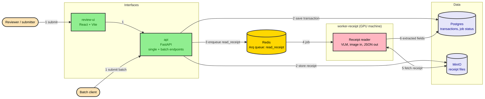
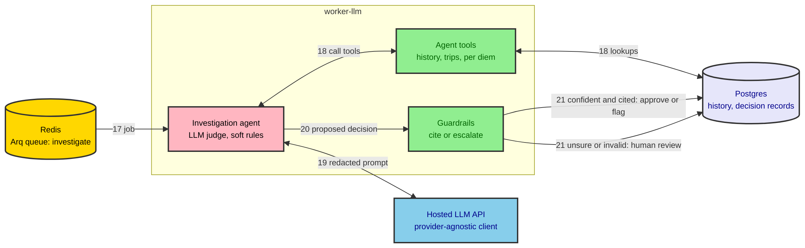
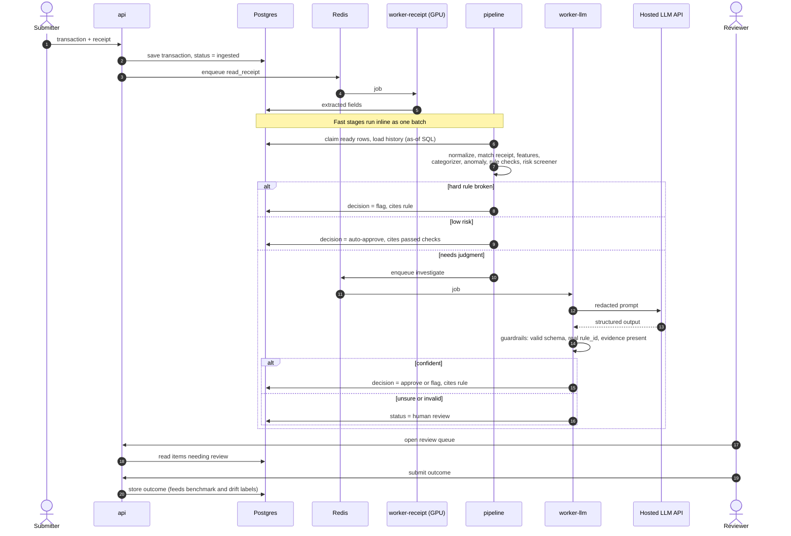
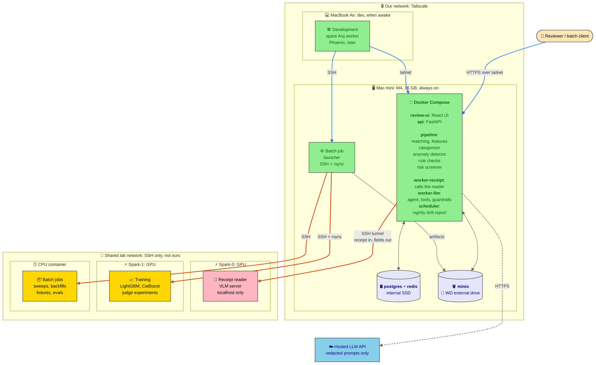
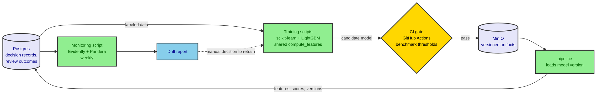

# Architecture (technology view)

This page shows where each component from `architecture.md` runs and what it is built with. The choices and their status are in `tech-stack.md`, and the reasons are in `decisions.md`. Components still marked TBD there are drawn without a specific technology.

There are six diagrams. Each answers one question:

| # | Question | Diagram |
|---|---|---|
| 1a–1c | What does each step do, and which container runs it? | Containers and steps: intake, pipeline, investigation |
| 2 | What happens to one transaction, in order? | Sequence |
| 3 | What runs on which machine? | Deployment |
| 4 | How are models trained, checked, and monitored? | Model lifecycle |

## 1. Containers and processing steps

These three diagrams follow one transaction from submission to decision. The step numbers carry on from one diagram to the next.

How to read them:

- **Boxes** are containers. The nodes inside are the steps from the logical view.
- **Pink** nodes are models, including the LLM judge. **Green** nodes are plain code.
- Only the receipt reader and the investigation agent go through the queue. Every other step runs directly in the pipeline container.

### 1a. Intake and receipt reading (steps 1-6)

A rendered copy is at [img/technology-1a-intake.svg](img/technology-1a-intake.svg).

### 1b. Pipeline (steps 7-16)

Every step in the pipeline container runs as one batch of function calls. There is no queue between the steps.

```mermaid
%%{init: {"flowchart": {"useMaxWidth": false}, "themeVariables": {"fontSize": "12px"}}}%%
flowchart LR
    pgin[("Postgres<br/>ready rows, history")]
    minio[("MinIO<br/>model artifacts")]

    subgraph PL["pipeline container (Python)"]
        norm["Normalization<br/>Pydantic, pure functions"]
        match["Receipt matching<br/>join receipt to transaction"]
        feat["compute_features<br/>pandas + SQL history"]
        cat["Categorizer<br/>scikit-learn / LightGBM"]
        anom["Anomaly detector<br/>LightGBM"]
        rules["Rule checks<br/>params from osu_rules.yaml"]
        screen["Risk screener<br/>heuristic, LightGBM later"]
    end

    pgout[("Postgres<br/>decision records")]
    redis[("Redis<br/>Arq queue: investigate")]

    pgin -->|"7 claim ready rows"| norm
    norm -->|"8 clean record"| match
    match -->|"9 matched record"| feat
    pgin <-->|"10 history, as-of SQL"| feat
    feat -->|"11 features"| cat
    feat -->|"11 features"| anom
    minio -->|"11 load model"| cat
    minio -->|"11 load model"| anom
    cat -->|"12 combined expense"| rules
    anom -->|"12 combined expense"| rules
    rules -->|"13 hard rule broken: flag"| pgout
    rules -->|"14 passes"| screen
    screen -->|"15 low risk: auto-approve"| pgout
    screen -->|"16 needs judgment"| redis

    classDef actor fill:#FFE4B5,stroke:#333,stroke-width:2px,color:black
    classDef app fill:#90EE90,stroke:#333,stroke-width:2px,color:darkgreen
    classDef model fill:#FFB6C1,stroke:#333,stroke-width:2px,color:black
    classDef store fill:#E6E6FA,stroke:#333,stroke-width:2px,color:darkblue
    classDef queue fill:#FFD700,stroke:#333,stroke-width:2px,color:black
    classDef external fill:#87CEEB,stroke:#333,stroke-width:2px,color:darkblue

    class norm,match,feat,rules app
    class cat,anom,screen model
    class pgin,pgout,minio store
    class redis queue
```

A rendered copy is at [img/technology-1b-pipeline.svg](img/technology-1b-pipeline.svg).

### 1c. Investigation (steps 17-21)

A rendered copy is at [img/technology-1c-investigation.svg](img/technology-1c-investigation.svg).

**All 21 steps:**

| Step | What happens |
|---|---|
| 1 | A reviewer submits through the UI, or a batch client sends transactions to the API. |
| 2–3 | The API saves the transaction in Postgres and the receipt in MinIO, then queues a job to read the receipt. |
| 4–6 | The GPU worker fetches the receipt, runs the receipt reader, and saves the extracted fields to Postgres. |
| 7–9 | The pipeline picks up rows that are ready, normalizes them, and matches each receipt to its transaction. |
| 10 | Features are computed. Each cardholder's history comes from SQL, using only data from before the transaction. |
| 11–12 | The categorizer and anomaly detector (loaded from MinIO) score the transaction. Their results make up the combined expense. |
| 13–14 | Rule checks run. A broken hard rule is flagged. Otherwise the transaction moves on. |
| 15–16 | The risk screener approves low-risk transactions and queues the rest for investigation. |
| 17–19 | The agent picks up the job, uses its tools to look up history and other data, and asks the hosted LLM. |
| 20–21 | Guardrails check the agent's proposed decision. If it is confident and cites a rule, it becomes approve or flag. Otherwise it goes to human review. |

## 2. One transaction, end to end

This diagram shows the same journey in time order. Its three branches are the decision engine's three outcomes. Fast steps run directly; slow ones go through the queue.

A rendered copy is at [img/technology-2-transaction-flow.svg](img/technology-2-transaction-flow.svg).

## 3. Deployment

This diagram shows which machine runs what, and which side opens each connection.

- The always-on core runs on hardware we own.
- The shared GPU and CPU machines are reached over SSH. They never connect back to us.

How to read the arrows:

- Each arrow points away from the side that opens the connection.
- **Blue:** inside our private network.
- **Orange:** to a shared machine, over SSH.
- **Dashed:** out to the internet.

Diagrams 1a–1c show how the services inside the Mac mini talk to each other.

A rendered copy is at [img/technology-3-deployment.svg](img/technology-3-deployment.svg).

| Machine | Owner | Runs | How it is reached |
|---|---|---|---|
| Mac mini | Ours, always on | Postgres, Redis, MinIO, API, UI, pipeline, workers, nightly drift report | Over the Tailscale network |
| MacBook Air | Ours, when awake | Development, spare worker, tracing | Over the Tailscale network |
| Spark-0 | Shared | Receipt reader model server | An SSH tunnel opened from the Mac mini. The server only accepts connections from its own machine. |
| Spark-1 | Shared | Training for the categorizer and anomaly models, and judge experiments | SSH and rsync from the Mac mini |
| CPU container | Shared | Batch jobs | SSH from the Mac mini or the Air |

Notes:

- **The shared machines hold nothing of ours.** They never connect to our services and have no passwords for Postgres, Redis, or MinIO. Receipts are sent to the reader inside the request and are not saved to disk there.
- **If the SSH tunnel drops,** receipt reading pauses. The queue retries once the tunnel is back.
- **The hosted LLM only sees redacted prompts.** A setting for each kind of data blocks this route entirely for real data.

## 4. Model lifecycle

This diagram shows how the three trained models are built, checked, deployed, and watched. It is all plain scripts and CI, not a running service.

A rendered copy is at [img/technology-4-model-lifecycle.svg](img/technology-4-model-lifecycle.svg).

## Not drawn

These are left out of the diagrams to keep them readable:

- Login, TLS, and private network details. See `security-and-guardrails.md`.
- Retries for each step, the dead-letter status, and the circuit breaker.
- The decision guards in the pipeline: hard rules win, the high-dollar check, and audit sampling.

## Still open in the stack

Not decided yet:

- The receipt reader model (waiting on the bake-off)
- The judge model
- The exact libraries for the trained models
- How receipt matching works
- The agent tools
- The guardrail thresholds

Leaning, but not final: the Arq worker setup and the receipt reader's queue.

The risk screener starts as a hand-tuned set of weights. It becomes a LightGBM model once there are enough review outcomes to train on.
