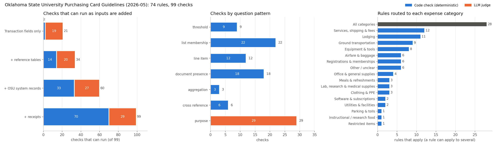

# Policies

Spending policies the review pipeline checks transactions against. Each organization gets its own folder; the pipeline reads the same file formats for every policy, so adding a new organization means adding files, not changing code.

```
policies/
├── README.md
├── scripts/
│   └── render_breakdown.py      # regenerates the chart, the tables below and the judge section
└── osu/                         # Oklahoma State University, Pcard Guidelines May 2026
    ├── source/Pcard-Guidelines-2026.05.pdf   # source of truth
    ├── osu_rules.yaml           # rules and their checks (for the engine, routing, citations)
    ├── osu_policy.md            # condensed policy for the LLM judge, tagged with rule and check IDs
    └── rule_breakdown.png       # chart of checks by input, pattern and category
```

The PDF in `source/` always wins over both files.

## Rules and checks

A **rule** is the policy unit: what the PDF says, with a stable ID (`OSU-TRV-13`), its text, the section and page it came from, a `severity`, and the expense categories it applies to. The judge cites rules, and evals check those citations.

A **check** is the evaluation unit. Most rules contain more than one condition. Car rental (OSU-TRV-13), for example, has four checks:

| Check | Asks | Method | Needs |
|---|---|---|---|
| OSU-TRV-13a | Rental is not entirely within Oklahoma | code | receipt |
| OSU-TRV-13b | Rental was not prepaid | code | transaction, receipt |
| OSU-TRV-13c | Justification, fare comparison and final receipt are on file | code | receipt, travel records |
| OSU-TRV-13d | Justification is sufficient, no personal miles | LLM | receipt, travel records |

Each check has exactly one method and one set of inputs, so there is no "partly deterministic" rule: a rule is simply a mix of code and LLM checks.

## How checks are classified

| Facet | Question | Values |
|---|---|---|
| `pattern` | What kind of question? Picks the checker implementation. | `threshold`, `list_membership`, `line_item`, `document_presence`, `aggregation`, `cross_reference`, `purpose` |
| `method` | Who decides? | `code` (deterministic once inputs exist) or `llm` (only for `purpose`) |
| `requires` | Inputs that must exist for the check to run | `transaction`, `table:<name>`, `records:<system>`, `receipt` |
| `uses` | Optional inputs that improve the evidence | same values as `requires` |
| `scope` | What the check looks at | `transaction`, `card`, `cardholder_window`, `department_window`, `billing_cycle`, `trip` |
| `role` | Is it a finding or a gate? | absent (normal check) or `gate`: only decides whether later checks run, never reported |
| `when` | Does it depend on another check? | `{check: <id>, result: ...}` or `{any_of: [...], result: ...}`; otherwise "not applicable" |
| `timing` | Can it be judged now? | absent (now) or `{due: purchase+24h \| cycle_end \| cycle_signoff}`; before the deadline a failure is "pending" |

Rule-level facets: `topic` (`limits`, `vendor`, `process`, `items`, `travel`) for reading and reporting, `severity` (`prohibited`, `conditional`, `documentation`, `guidance`) for what a failure means, and `applies_to` for routing by expense category.

**Gates and dependencies.** Some conditions only matter after another one. An airfare upgrade is fine with a documented medical reason, so "receipt shows an upgrade" (OSU-TRV-04a) is a *gate*, and "a documented reason is on file" (OSU-TRV-04b) runs only when the gate is true. The same pattern covers gift cards (OSU-PRH-10a detects them, then the OSU-RST-06 checks run), split purchases (candidate groups, then the judge), food approval and resale permits. Gates keep the engine from reporting a condition that is fine in context.

**Deadlines.** Documents and approvals are attached during reconciliation, the asset report is due within 24 hours, and cycle totals aren't final until the cycle ends. Checks with `timing` report *pending* until their deadline, so a missing receipt on day one isn't a violation.

**Patterns map to checkers.** The engine needs one implementation per pattern (seven in total), not one per rule. A new policy is mostly YAML.

**Inputs gate checks.** If any `requires` input is missing, the check reports *not evaluated: missing \<input\>* instead of pass or fail. A deployment lists the inputs it has, and checks switch on as inputs are added, with no change to the rules. The input kinds:

- `table:<name>`: a maintained reference table, such as MCC lists, the OSU-department merchant list, GSA lodging rates, or campus addresses. Kept by a separate process and versioned.
- `records:<system>`: OSU system records. `works` holds card, fund, description and trip number; `hr` holds employee type; `airs` holds travel requests; the others are `asset_mgmt`, `coi` (conflict-of-interest disclosures), `approvals` and `accounts_payable`. These are integrations, and some are time-dependent (an asset report is due within 24 hours).
- `receipt`: the receipt or hotel folio extracted into fields: lines, tax, tip, fees, fare class, dates, addresses.

**LLM checks** (pattern `purpose`) also carry:
- **`decision`**: draft criteria, as `violation` / `allowed` / `unclear` (guidance uses `flag`). `unclear` is the right answer when the evidence doesn't show what was bought or why. These criteria are our reading of the policy and **must be confirmed by OSU**.
- **`screen`** (optional): a cheap signal that selects candidates for the judge, such as a merchant or MCC pattern. A match only means "review".

The LLM judge reads `osu_policy.md`. Its section 6, the list of checks the judge decides, is generated from the YAML, so it can't drift from the rules.

## OSU breakdown



74 rules, 99 checks: 70 code (6 of them gates), 29 LLM.

**Checks that can run as inputs are added** (cumulative):

| Inputs available | Code checks | LLM checks | Total runnable | Share of checks |
|---|---|---|---|---|
| Transaction fields only | 2 | 19 | 21 | 21% |
| + reference tables | 14 | 20 | 34 | 34% |
| + OSU system records | 33 | 27 | 60 | 61% |
| + receipts | 70 | 29 | 99 | 100% |

**Checks by pattern:**

| Pattern | Code | LLM | Total |
|---|---|---|---|
| threshold | 9 | 0 | 9 |
| list_membership | 22 | 0 | 22 |
| line_item | 12 | 0 | 12 |
| document_presence | 18 | 0 | 18 |
| aggregation | 3 | 0 | 3 |
| cross_reference | 6 | 0 | 6 |
| purpose | 0 | 29 | 29 |
| **Total** | **70** | **29** | **99** |

What this means for the pipeline:
- **71% of checks are deterministic** (70 of 99). Only questions about what something is, who it was for, or why go to the LLM.
- **With transaction fields alone, almost nothing deterministic can run.** Only 2 code checks: the $10,000 limit and the same-merchant split-purchase gate. Most of the 21 runnable checks are LLM checks working from item text, and in this data 44% of item text is generic, so expect many `unclear` answers.
- **Reference tables are the cheapest gain** (+12 code checks). Most are small lists that come straight from the policy, such as the alcohol, postage, insurance and licensed-profession MCCs.
- **Receipts unlock the most** (+37 code checks): tax, tips, fees, fare class, folio lines and terms. Without receipts, 39 checks report "not evaluated" (37 code, plus 2 LLM checks that can only be judged from the receipt: restocking fees and rental mileage).
- **28 rules apply to every transaction.** Services/shipping (12) and lodging (11) have the most category-specific rules.

## Regenerating

```bash
python policies/scripts/render_breakdown.py policies/osu/osu_rules.yaml
```

This rewrites `rule_breakdown.png`, refreshes the generated judge section in `osu_policy.md`, and prints the tables above. Paste the tables here if the counts change. It needs `pyyaml` and `matplotlib` (see `requirements.txt`).

## Status and review

The OSU files are a **draft generated from the PDF**. Automated checks pass:
- Every rule's cited page contains its source wording and numbers.
- The YAML and markdown cite the same IDs.
- Every data count quoted in `hints` was recounted.
- Every check has valid facets.
- Every LLM check has decision criteria.

The meaning of each rule, how rules were split into checks, and the decision criteria have only been reviewed by the same process that drafted them. A human should check them against the PDF before they drive labels or evals.

Documents the guidelines reference but that are not included (rules depending on them may be incomplete): the food and drink guidelines, travel policy 3-0201, policy 1-1301 (weapons list), the gift card guidelines, and the OK Corral procurement guidelines.

## Adding a policy

1. Put the source document in `policies/<org>/source/`.
2. Write `<org>_rules.yaml` with the same schema (rules with `checks`) and the category list from `osu_rules.yaml` (or extend it). Use IDs prefixed `<ORG>-`.
3. Write `<org>_policy.md` for the judge. Include the two `GENERATED: judge checks` marker comments where the generated check list should go.
4. Run `render_breakdown.py` and add the breakdown to this README.
